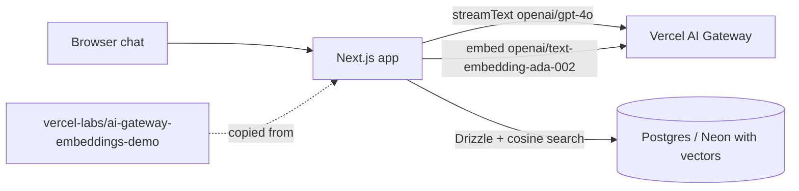

# vercel-ai-gateway-embeddings-demo

A copy of Vercel's public sample chatbot that remembers facts you paste in and answers questions only from them (a basic retrieval-augmented generation demo). It is unrelated to the Gulf Coast / CyberCheck platform.

## What it is

A Next.js chat app. You paste text into the chat; the app splits it into sentences, turns each into an embedding through the Vercel AI Gateway, and stores it in Postgres. When you ask a question, the app embeds it, finds the closest stored sentences, and the model answers using only those, or replies "Sorry, I don't know." The README's deploy button points to the upstream project `vercel-labs/ai-gateway-embeddings-demo`, and the repo carries a Vercel `LICENSE.txt`. I could not diff it against upstream, so I do not know whether anything was changed.

## How it works

- `app/page.tsx` - the chat UI.
- `app/api/chat/route.ts` - streams a reply with the Vercel AI SDK (`streamText`, model `openai/gpt-4o`) and two tools: `addResource` and `getInformation`.
- `lib/actions/resources.ts` - saves a pasted resource and its embeddings.
- `lib/ai/embedding.ts` - splits text on `.`, embeds with `openai/text-embedding-ada-002`, and searches by cosine similarity (threshold 0.5, top 4).
- `lib/db/schema/{resources,embeddings}.ts` and `lib/db/migrations/0000_yielding_bloodaxe.sql` - Drizzle schema and migration for Postgres with a vector column.
- `lib/env.mjs` - requires `DATABASE_URL`.

## Run it

Needs a Postgres database with pgvector (the original uses Neon) and a Vercel project for AI Gateway access.

```bash
vc link                 # link to a Vercel project
vc env pull             # pulls DATABASE_URL and the AI Gateway OIDC token
pnpm i
pnpm db:migrate && pnpm db:push
vc dev                  # http://localhost:3000
```

Environment variable name required by the code: `DATABASE_URL`. AI Gateway access comes from Vercel's OIDC token via `vc env pull` (see the original README notes).

## Status

**Asset dump.** A third-party sample app parked in the account (single commit, 2026-04-04), with no link to any other CultureReset repo.

## Where it fits



## Related repos

- Upstream: `vercel-labs/ai-gateway-embeddings-demo` (not a CultureReset repo).
- No CultureReset repo uses or feeds this one.
